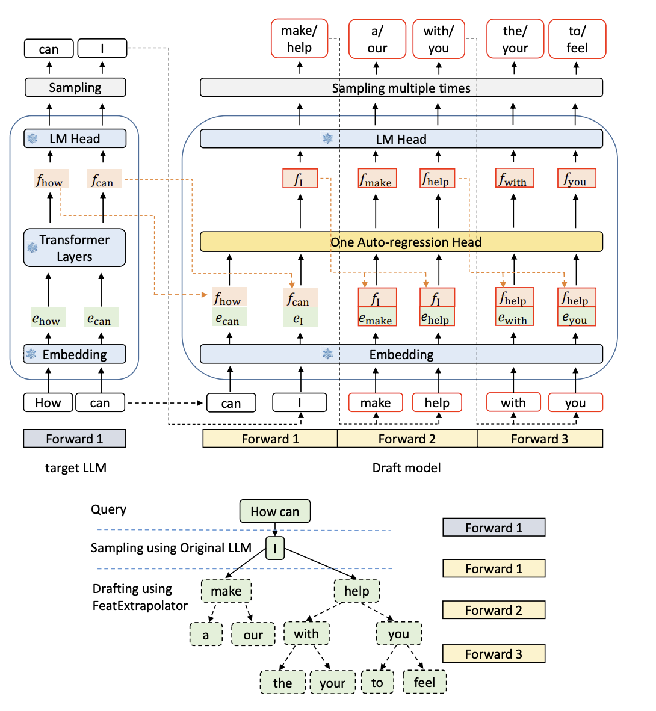

分为两个阶段：draft 和 veriy 阶段

直观来看，speculative decoding 自身存在的问题有：
1. 需要使用一个 draft 模型，但是这个模型会引入额外的开销
2. 不同的 draft 模型可能和原始的模型并不相适应
3. 如果专门训练一个 draft 模型成本也很高
4. 如何降低 speculative decoding 的 overhead，以及如何提高 verify 阶段的接受率

一般来说会使用一个同家族的小参数量的模型，让 token 生成的概率分布更接近，接受的概率也更高一点；由于需要一个独立的新模型，其实成本还是很高的

所以来说，一个优化的思路就是复用已有的 llm 的权重，然后训练一个较小的增量权重，用这个额外的权重来进行预测 draft token（也就是 self-drafting）

## Medusa

在原来的 LLM 基础上面插入若干个 Medusa Head，通过这个新的 head 去生成不同的 draft tokens

LLM head 负责 next token，medusa head 1 负责 next next token；以此类推，一个 3 个 medusa head；每个 medusa head 的输入是原始 llm 模型的 hidden state 而非 token embedding，所以 mesuda 是 feature level 的

假设 medusa heads 数量为 N，每次 draft 会同时生成 N 步；每一步的 token 的数量是 $K_i$,
所以候选路径数量： $P = \prod_{i=1}^{N} K_i$
如果每一个的候选数量相同都是 K，那么 $P = K^N$

候选树：

比如第一步 有 a b
第二步里面， a 下面是 c d，b 下面是 e f
所以一共有 4 条路径

由于串行验证的成本是巨大的，比如当每一步有 3 个候选，然后一共 4 步，就有 81 次调用，非常浪费，因此 medusa 使用了 Tree Attention 的方法

Tree Attention 是把一个树所有节点展平为一个一维序列，比如
`[root,a,b,c,d,e,f]`
如果使用一个Casual Mask，后面的 token 会看到前面所有的 token，比如 c 可以看到 b，但是 c 和 b 压根都不在一个分支上，所以需要设计一个 Tree Mask，需要让每个 token 只能看到自己和树上的祖先节点，不能看到其他的兄弟分支和未来节点。

原文给的head1-4 的 draft token 数量是`[10,10,9,4]`

验证的时候，llm 对每条路径从根节点开始比较，llm 在父节点的位置预测下一个 token，如果和 draft token 相同就继续前往下一层，如果不匹配的话这个路径就停止。所有路径都会进行并行比较，然后选择余承恩连续匹配路径最长的 路径作为最终的接受路径。

Medusa 的优势包括：
1. draft 是 self drafting，只需要加几个 medusa head，通过 sft 即可获得 medusa 模型。 有两种训练方式：medusa1 是冻结主干，只训练 medusa head；medusa2 是联合主干模型进行微调，精度会相对更高一点
2. 通过 Tree attention 并行的来验证多个路径，提高单次投机采样的接收长度。并且在 hidden 状态中采样（而非 token level）的效果一般会更好一点。

但是medusa 也有一些问题：
1. draft token 不知道上一个 token 是啥，因为使用 hidden 状态并行预测多步 draft token，也就是缺少未来 token 之间的自回归依赖
2. medusa 利用 decode 阶段算力利用率低的特点，用算力换时间，通过增大单次推理的计算，降低总的推理次数吗。也就是通过增加候选使得命中正确路径的机会更大。但是算力资源是有限的。

## EAGLE

使用原始法模型的倒数第二层的 hidden 特征，而非直接预测 token，也就是说 draft 模型预测的是特征序列，而不是 token 序列，然后原始的大模型的 head 把 hidden 特征解码为真实的 token

token embedding 是文本的转化而非深层网络提取的特征，是缺乏表达能力的。而最后一层的输出才是 token 的隐藏层特征。

引入历史 token 信息，预测下一个特征时，使用前一时刻特征和当前时刻采样的 token 的 embedding。 因为 Medusa 只用了隐藏层特征没有使用 token 的 embedding，所以 eagle 这里给它补上了，这样生成 draft token 的时候就具备足够的信息，增加 token的生成效果。 作者实验 也发现 如果使用 这种融合的算法加速比和接受率 是最高的

比如预测 How can

- 首先通过 sampling using original LLM 得到 I
- 然后 基于 I 进行 draft：得到两个 make / help； 这里面 生成 make 的时候 $f_{can},e_I$ 也就是前一个时刻的 can 的隐藏层特征和当前输入的 I 的 embedding 
注意索引：

- Feature：$f_1,f_2,\ldots,f_i$
- Token：$t_2,t_3,\ldots,t_{i+1}$

medusa 的树是通过 draft tokens 的 笛卡尔积生成的，而 eagle 的树是通过不同的 draft token，生成不同的新的子节点。这样就是天然去掉了树中的无用的分支，verify 时候所需要验证的序列的长度大大缩小，并且路径中的节点是有参考过前一个时刻的信息的，所以这样接受率也会更高一点

在 verify 阶段，eagle 同样使用 medusa 的 tree attention 的方法来进行验证

eagle1 的训练有两个目标 ：
1. feature regression，让 draft model 预测的特征尽可能接近原模型的真实 feature，loss 使用 smoothl1
2. 预测的是 feature，但是实际最终预测目标还是 token，所以还需预测让预测的概率分布接近原始的 LLM。
$$
 p=\operatorname{Softmax}(W_{\mathrm{head}}f_{i+1}) \\

 \hat p=\operatorname{Softmax}(W_{\mathrm{head}}\hat f_{i+1}) \\

\mathcal L_{\mathrm{cls}} = -\sum_{v\in\mathcal V}p(v)\log\hat p(v) （cross  Entropy）
$$

论文还在训练时向真实 Feature 添加小幅均匀噪声，以缓解推理时反复使用预测 Feature 产生的误差累积。

EAGLE 1的后续预测依赖于此前生成的 feature 和 token。
## EAGLE 2

EAGLE 1 发现的几个现象：
- 接受率除了跟 token 在树中位置有关，还和 context 相关，也就是树中的祖先节点
- 可以通过 draft tokens 的生成概率去预估 token 的接受率。eagle 的 draft token 的概率分布和 token1 的接受率分布接近。也就是 draft confidence 和 acceptance rate 相接近。因此可以在不调用 target LLM 的情况下，先预先估计一下输出的概率分布中，那些分支更适合去扩展。也就是 confidence 比较高的节点去多扩展。

eagle 2 提出Context-Aware Dynamic Draft Tree，通过 token 的联合概率去预估接受率。利用接受率动态的展开 draft tree，在树节点个数不变的情况下提高 draft tokens 的接受长度。

$$
V_i = \prod_{t_j \in Path(root,t_i)}c_j \\
c_j = Confidence(t_j)
$$
Expand阶段：

每个节点包含路径的概率信息，通过将路径上边的权重相乘得到。Expand 过程中，当展开的节点的概率值小于阈值时，则停止该节点继续展开，否则继续展开。
每个节点取前 2 个子节点进行 Expand。当节点概率小于 0.1 时，不再对该 Token 采样下一个 Token。

Rerank 阶段：
保留概率最高的 K 个节点，其余的删掉。如果概率相当，保留浅层的
由于 child 节点概率必然小于parent 节点，因此树的结构是稳定的

然后把保留剩下的节点展平为一维序列，构建对应的tree attention mask 后让 target LLM 进行一次验证。实验结果表明，加速倍数更高

假设：

- $C_T$：Target LLM 普通 Decode 一次的延迟。
    
- $C_D$：Draft Model 一次 Forward 的延迟。
    
- $C_V(m)$：Target LLM 验证 \(m\) 个候选节点所需延迟。
    
- $d$：Draft 模型的扩展轮数。
    
- $\tau$：每轮验证平均产生的有效 token 数。
    
- $C_O$\)$：树构建、采样、缓存管理等额外开销。
    

那么近似的加速比为：
$$ \boxed{ S\approx \frac{\tau C_T} {dC_D+C_V(m)+C_O} } $$

EAGLE2 存在的问题：
1. 如果 draft confidence 和 acceptance rate 差距大，那么会影响树本身路径选择的效果
2. 候选树越大，verify 阶段的计算开销就越大，EAGLE-2 仍然依赖 EAGLE-1 的 Draft Model。如果需要加速一个新架构的 LLM，通常仍然需要针对该模型获得兼容的 Draft Model 权重，并正确处理特征、LM Head 和 KV Cache

---

L1 是绝对值误差，对于大误差相对不敏感，更鲁棒。易产生稀疏解，常用于特征选择和稀疏化
L2是平方误差，函数光滑处处可导，mse 就是平均平方误差。对大误差惩罚更重，因为误差被平方放大，对离群点更敏感。
SmoothL1 是二者折中，误差小的时候像 L2，误差大的时候像 L1

----

## LOOKAHEAD

基于 Jacobi Decoding：

每一个 token的预测是一个方程，所以可以通过并行求解方程来做；先初始化一组预测
$$Y^{(0)}=(y_1^{(0)},y_2^{(0)},y_3^{(0)},y_4^{(0)})$$

每一轮同时预测四个位置，并且这样的方法所需要的步骤一定小于自回归解码所需要的步骤，因为每一次至少都能保证一个 token 最终迭代完成，也就是最差的情况下就是每次只接受一个 token

jacobi decoding 的方法虽然可以并行预测，但是每一轮都是使用其他位置的旧预测，导致尝尝需要重新预测（接受率很低）。此外 token 预测正确了不代表预测正确了。 很可能预测出来了一个正确的片段，但是位置不正确，下一轮迭代之后这段预测又要重新预测。

LOOKAHEAD 的发现 虽然整个序列可能还不对，但是相邻位置之间已经可能形成正确的局部 token。Lookahead 就将这种局部连续片段保存为 n-gram，并在后续解码中重复利用。

一个重要的超参数是随机生成的 tokens 的数量。在 Lookahead Decoding 中，该超参被视为前向的 Window 大小，记作 **W**。同时，Lookahead Decoding 还需关注 N-gram 的长度，记作 **N**。

## ReDrafter

使用一个 RNN 作为 draft model，根据当前步生成的 token 的 embedding 来更新 RNN 的 hidden state

$$
s_t = f(Us_{t-1} + We_t + b)
$$
然后和 LLM 的 hidden state 进行拼接，然后用 MLP+ Softmax 去预测下一个 token

同时 redrafter 还引入了 beam search 

## PEARL